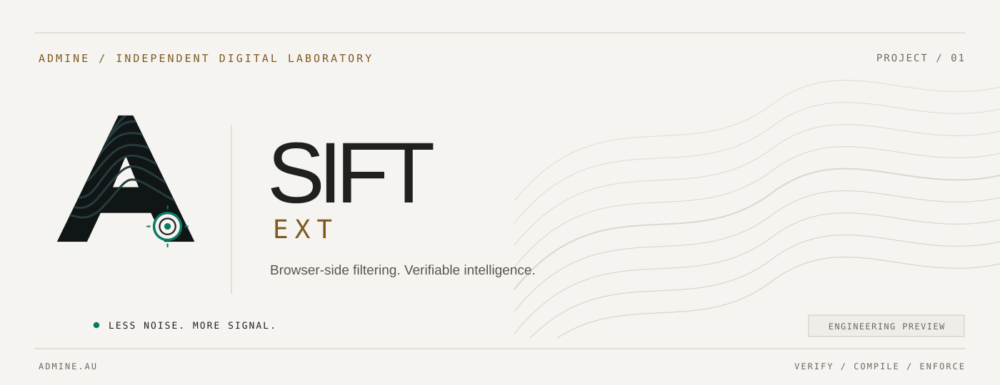
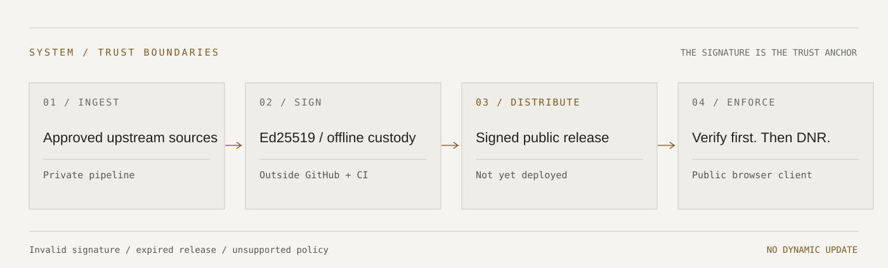

<p align="center">
  <picture>
    <source media="(prefers-color-scheme: dark)" srcset="docs/media/sift-hero.svg"/>
    
  </picture>
</p>

<p align="center">
  <a href="https://github.com/0xdx-au/sift-ext/actions/workflows/client-tests.yml"></a>
  <a href="https://github.com/0xdx-au/sift-ext/actions/workflows/browser-e2e.yml"></a>
  
  
</p>

<p align="center">
  <a href="https://admine.au/">ADMINE</a> ·
  <a href="#what-is-sift-ext">Overview</a> ·
  <a href="#trust-is-the-feature">Architecture</a> ·
  <a href="#run-the-engineering-preview">Try the source</a> ·
  <a href="#where-things-stand">Release status</a> ·
  <a href="SECURITY.md">Security</a>
</p>

---

## What is SIFT EXT?

**An ADMINE browser-side filtering instrument with a verifiable intelligence pipeline.** SIFT EXT is the public-facing half of ADMINE's SIFT project: one part local request filtering, one part careful link cleanup, and one part signed policy verification.

It is built for **inspection, predictable behaviour and honest results**. No mystery counters. No fabricated protection score. No pretending that a rule blocked something when the browser never enforced it.

> [!IMPORTANT]
> **Engineering preview, not a released browser extension.** The current `main` branch contains the public project and governance materials. Implementation and passing test work live in the [engineering preview branch](https://github.com/0xdx-au/sift-ext/tree/engineering/p0-p1-client-20261115) and [draft PR #1](https://github.com/0xdx-au/sift-ext/pull/1). A production signing key, live feed updates and store-distributed build are **not enabled**.

### What you can inspect today

| Capability | Engineering state |
| :--- | :--- |
| **Bundled request protection** | MV3 declarativeNetRequest starter rules; real pause/resume, tested in headless Chromium |
| **Clean tracking links** | Explicit manual cleanup; leaves signed, login, payment and invite links alone |
| **Signed intelligence verification** | Ed25519 signature, SHA-256, expiry, bounds and anti-rollback tests |
| **Authenticated recovery** | Signed payload/proof retained; tampering quarantined instead of being installed |
| **Source security** | No persistent browsing-history capture, no injected content scripts, no analytics integration in the current preview |

The point is not to block the most requests. It is to **block the right requests, understand exactly why, and avoid breaking what matters**.

## Trust is the feature

<p align="center">
  <picture>
    <source media="(prefers-color-scheme: dark)" srcset="docs/media/sift-flow.svg"/>
    
  </picture>
</p>

Two repositories, deliberately separated:

| | Repository | Boundary |
| :--- | :--- | :--- |
| **SIFT** | Private intelligence pipeline | Source acquisition, policy compilation and publishing workflow |
| **SIFT EXT** | **This public repository** | Browser UI, local rules, signature verification and adapter logic |

The private repository isn't a browser API and isn't available to the extension. **No private signing key or GitHub credential should ever be inside a client build.** The public release route is planned for `admine.au`; it is not live.

This is **browser request filtering**, not network-wide DNS security, not an antivirus engine and not a substitute for browser-native protections.

## Run the engineering preview

The source isn't on `main` yet. Inspect or run the reviewed development branch without assuming it is a published extension:

```bash
git clone --branch engineering/p0-p1-client-20261115 \
  https://github.com/0xdx-au/sift-ext.git
cd sift-ext

# Requires Node.js 26 LTS
npm run check
npm test
```

To test the bundled client in a Chromium-based browser, review `manifest.json` and use **Load unpacked** on the cloned directory in the browser's extensions developer screen. This is for local testing, **not** a recommended everyday-protection release. The automated installed-browser suite is in the [engineering CI workflow](https://github.com/0xdx-au/sift-ext/actions/workflows/browser-e2e.yml).

Browser capabilities differ. A successful Chromium test does **not** certify Edge, Brave or Safari.

## Where things stand

| Milestone | State |
| :--- | :--- |
| Public client source + governance | In engineering review |
| Local filtering and popup interaction | Tested in installed Chromium |
| Signed feed parsing, authenticity and recovery | Tested with disposable signing fixtures |
| Approved production public-key pin | **Not provisioned** |
| Signed-feed CDN / automatic updates | **Not deployed** |
| Edge and Brave installed-browser validation | Not complete |
| Safari-specific implementation | Not complete |
| Browser-store submission | **Not submitted** |

[Engineering issues](https://github.com/0xdx-au/sift-ext/issues) track the remaining security, compatibility and product work. [Draft PR #1](https://github.com/0xdx-au/sift-ext/pull/1) carries the current implementation.

## Your privacy should not be the price of protection

The current client is designed to filter requests **in the browser** using declarativeNetRequest. The manual URL cleaner runs locally and does not send the submitted link to a service. The preview declares `declarativeNetRequest`, `storage` and `activeTab` permissions, with **no persistent host permissions** and no content-script injection.

Signed feed retrieval is not enabled until a public signing key has been approved and pinned. The planned publisher is separate from client execution; no analytics integration or browsing-history upload is implemented in the preview.

See the [security policy](SECURITY.md) and the engineering [protocol design](https://github.com/0xdx-au/sift-ext/blob/engineering/p0-p1-client-20261115/docs/PROTOCOL.md). These are implementation claims, **not** an independent privacy audit of a production release.

## Open to scrutiny. Not automatically open-source.

SIFT EXT is **publicly viewable and rights reserved**. You can inspect the source, tests and security design, but public visibility is not a grant to redistribute, modify or sell the code. ADMINE may offer commercial or differently licensed builds later.

Read [LICENSE](LICENSE), [COMMERCIAL.md](COMMERCIAL.md) and [third-party notices](NOTICE.md). Upstream filter-list rights and attribution must be reviewed before any live-feed distribution.

Found a bug? Open an [issue](https://github.com/0xdx-au/sift-ext/issues). Found a vulnerability? Follow [private disclosure guidance](SECURITY.md); **do not post sensitive details publicly**.

---

<p align="center">
  <sub>Built by <a href="https://admine.au/">ADMINE</a> · Less noise. More signal.<br/>
  Visuals in this README are original architecture illustrations, not screenshots of a released browser product.</sub>
</p>
